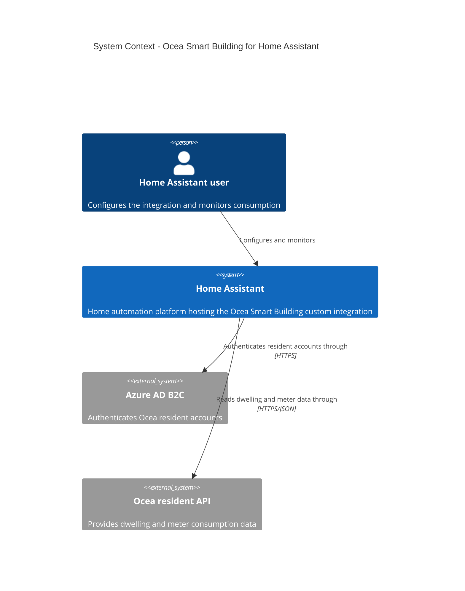
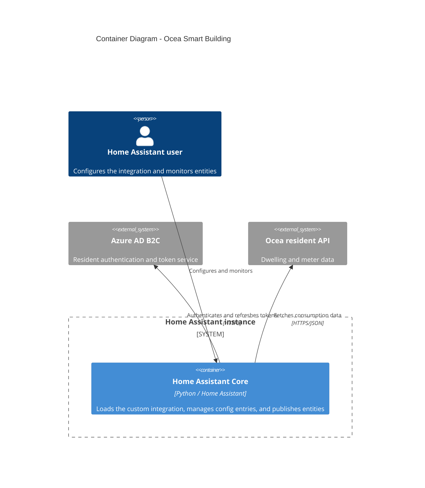
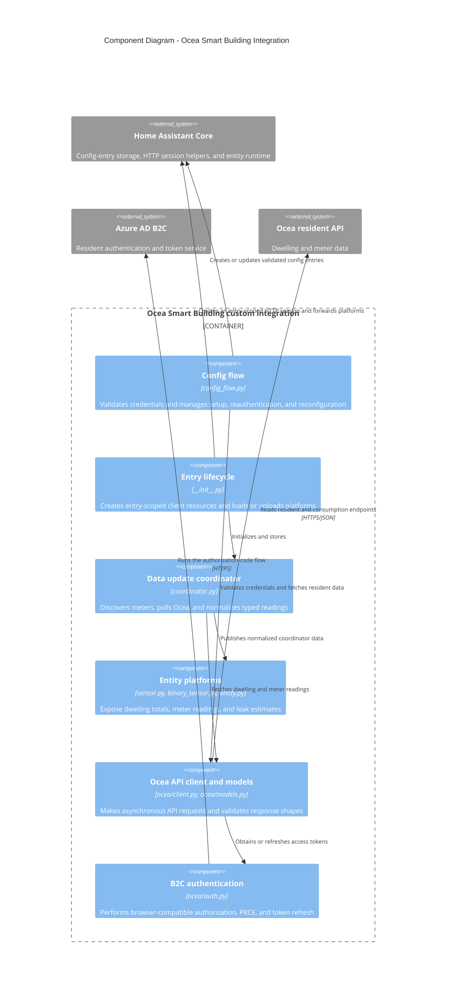

# Architecture

This document describes the responsibilities and boundaries of the Ocea Smart
Building integration for contributors and coding agents. User-facing setup and
sensor behavior is documented in the root [README](../README.md); repository
workflow and privacy requirements are in [AGENTS.md](../AGENTS.md).

## System context

The integration is loaded into Home Assistant Core; it is not an independently
deployed service. The standalone [`ocea_cli.py`](../ocea_cli.py) is a separate
manual testing tool, not part of the integration's runtime.

## Containers

Home Assistant's config-entry store persists validated credentials and the
discovered dwelling identifier. The integration keeps access and refresh tokens
in memory; it does not persist them.

## Integration components

Home Assistant lifecycle and presentation concerns stay in the integration
modules. The `ocea/` package owns Ocea HTTP requests, response-shape validation,
authentication, API models, and client exceptions. Resident information and
dwelling details, including structured addresses, are converted to typed
models at the client boundary. Address formatting belongs to the config flow.

## Runtime flow

The initial setup, reauthentication, and reconfiguration flows validate the
submitted credentials through B2C, retrieve the typed resident, and check
access to the dwelling before saving anything. The client exposes these as
separate authentication and resident-retrieval operations. Initial setup selects
an accessible dwelling, while reauthentication and reconfiguration preserve
the configured dwelling and update the title from validated resident data.
Reconfiguration keeps the stored password hidden and applies changes through
`data_updates` so unrelated entry data is retained.

When an entry is set up, the integration creates its own Home Assistant-managed
HTTP session and API client, then starts the coordinator. The first coordinator
refresh discovers the dwelling's supported water meters and associated device
metadata. Meter discovery is cached for the loaded entry. The coordinator then
fetches dwelling totals and each discovered meter's current-month readings on
the five-hour interval. Entity platforms expose the resulting data to Home
Assistant. A meter-specific read failure does not discard successful readings
from other meters or the dwelling totals; missing leak estimates remain
unavailable rather than being reported as “no leak.”

## Integration modules

| Module | Responsibility |
| --- | --- |
| `__init__.py` | Config-entry lifecycle: create the entry-scoped HTTP session and API client, perform the first coordinator refresh, forward platforms, and unload them. |
| `config_flow.py` | Initial setup, reauthentication, and reconfiguration. Validate credentials with the client, derive the dwelling ID and title from resident data, and persist the validated config. |
| `coordinator.py` | Discover PDS/meter metadata at startup; fetch and normalize dwelling totals and per-meter readings; expose a typed coordinator payload and translate API failures to Home Assistant update/auth errors. |
| `entity.py` | Shared coordinator entity base, device metadata, and stable unique-ID construction for dwelling and meter entities. |
| `sensor.py` | Dwelling-level and per-meter water/heating sensors, plus estimated-leak measurement sensors when Ocea provides estimates. |
| `binary_sensor.py` | Per-meter leak state, derived from the latest estimated-leak value. Missing estimates are represented as unavailable, not as “no leak.” |
| `const.py` | Integration domain, version/User-Agent, config keys, polling interval, and fluid-to-sensor mapping. |
| `strings.json`, `translations/` | Config-flow, entity, and device translations. Keep the source and English/French translations aligned when translated keys change. |
| `ocea/` | Asynchronous Ocea API client, browser-compatible B2C authentication, API models, protocol constants, and client exceptions. This package uses but does not own the injected HTTP session. |
| `ocea_cli.py` | Standalone manual API-testing CLI. It intentionally runs without Home Assistant and uses `requests`; it is not the integration's runtime client. |

Tests live under `tests/`. Config-flow and entry lifecycle behavior is covered
in `test_config_flow.py` and `test_setup.py`; coordinator and sensor behavior in
`test_consumption_sensors.py`, `test_api_meters.py`, and
`test_leak_binary_sensor.py`; authentication/client behavior in
`test_ocea_client.py`; and API model validation in `test_models.py`.

## Boundaries and invariants

- The integration owns the lifetime of the Home Assistant-created session;
  `OceaApiClient` and `OceaAuthentication` use it but do not close it. Config
  flows use their own isolated sessions so cookies are not shared across
  accounts or flow attempts.
- Preserve the browser-compatible B2C flow, including cookie handling, PKCE,
  redirect parsing, and the User-Agent prefix. Authentication changes require
  focused client tests.
- Credentials are stored in config-entry data; access and refresh tokens are
  held by the client in memory. Never put credentials, tokens, cookies,
  resident/dwelling identifiers, or authenticated API responses in logs,
  documentation, fixtures, or committed output.
- Entity unique IDs are derived from the dwelling and, for meter entities, the
  PDS identifier. Changing this scheme can orphan existing entities; treat it
  as a migration, not a cosmetic refactor.
- PDS discovery is cached for the lifetime of the loaded entry. Reload the
  integration to synchronize meter additions or removals.
- Keep the polling interval at five hours unless a separately requested and
  tested behavior change says otherwise.

When behavior or module ownership changes, update this document alongside the
affected implementation and tests.
