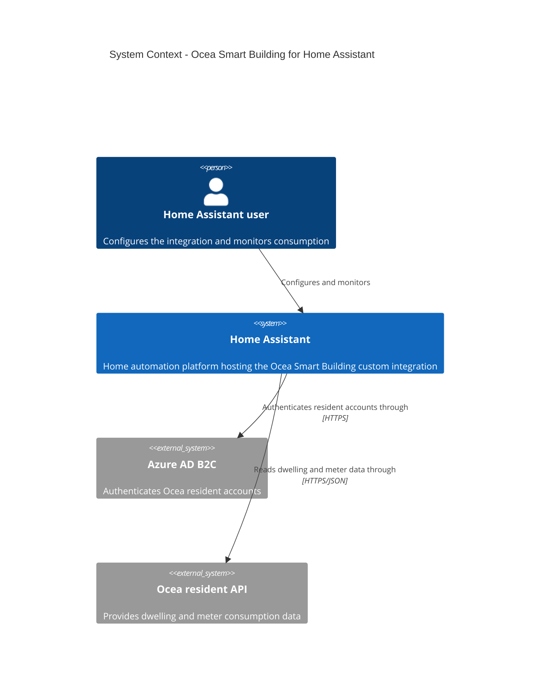
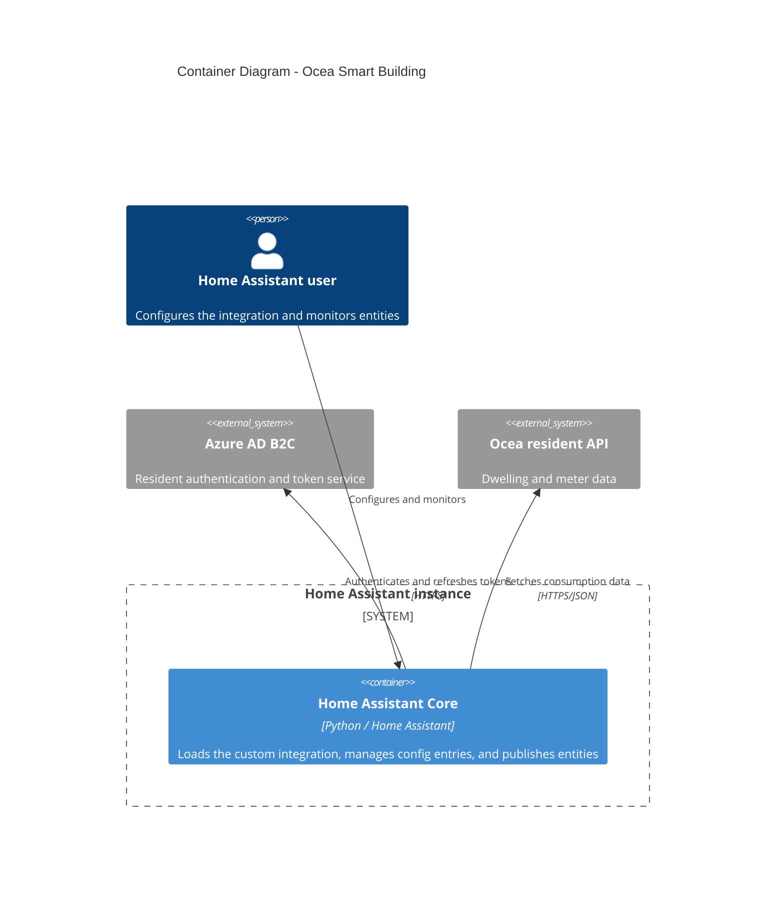
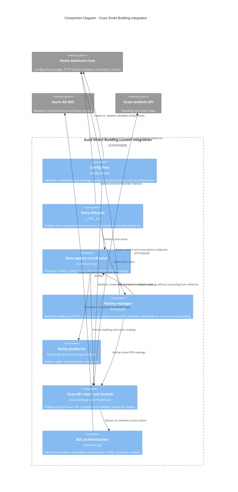

# Architecture

This document describes the responsibilities and boundaries of the Ocea Smart
Building integration for contributors and coding agents. User-facing setup and
sensor behavior is documented in the root [README](../README.md); repository
workflow and privacy requirements are in [AGENTS.md](../AGENTS.md).

## System context

The integration is loaded into Home Assistant Core; it is not an independently
deployed service. The standalone [`ocea_cli.py`](../ocea_cli.py) is a separate
manual testing tool, not part of the integration's runtime.

## Containers

Home Assistant's config-entry store persists validated credentials and the
discovered dwelling identifier. The integration keeps access and refresh tokens
in memory; it does not persist them.

## Integration components

Home Assistant lifecycle and presentation concerns stay in the integration
modules. The `ocea/` package owns Ocea HTTP requests, response-shape validation,
authentication, API models, and client exceptions. Resident information and
dwelling details, including structured addresses, are converted to typed
models at the client boundary. JSON request and response contracts also live
in `ocea/models.py`; known fields used by the coordinator are validated and
converted to model attributes at the client boundary. Additional fields are
retained in the models' raw data, which must never be logged. The models do
not represent a complete server schema. Address formatting belongs to the
config flow.

For dated consumption items, the client distinguishes generic, water and RFC
responses using `type`; only the water variant declares `fuiteEstimee`.
The client also retains an unclassified shape for missing, unknown or
incompletely understood variants. Type guards check the discriminator and
variant fields before constructing the typed models, without rejecting
previously accepted data.
Legacy leak fields remain usable even when the discriminator is missing.

Dashboard and consumption values are converted to finite `Decimal` values at
the API boundary. Dated readings use `date` for calendar-only dates and
timezone-aware `datetime` for timestamps. Explicit offsets are preserved;
naive timestamps are interpreted in `Europe/Paris`. Ambiguous or nonexistent
local times are invalid rather than guessed. When the latest calendar-only
reading cannot be ordered against a timestamp on the same Paris day, its
latest-reading metadata is unavailable.

The coordinator ignores individual consumption readings with invalid or
missing dates or values, warns without logging their contents, and aggregates
the remaining values. A partial total can understate actual consumption; a
nonempty series with no valid readings is unavailable. An empty series keeps
its existing behavior. Latest-reading metadata is unavailable when an invalid
date prevents ordering or the latest reading is invalid, so a stale leak
estimate cannot be reported as current. Numeric values are converted to floats
at the sensor boundary to preserve Home Assistant's exposed values. The dashboard
accepts the exact API fluid code `Cetc`; unsupported fluid codes are ignored with
a sanitized warning. History synchronization only advances when all dated
readings in a response are valid, even if the coordinator has a partial total.

The client owns authentication state but is not bound to a dwelling. Each
dwelling-specific call receives its local ID explicitly, and POST methods
receive their complete typed payload from the caller. Dynamic URL segments are
encoded independently. The coordinator constructs the device and consumption
requests for the configured dwelling.

## Runtime flow

The initial setup, reauthentication, and reconfiguration flows validate the
submitted credentials through B2C, retrieve the typed resident, and check
access to the dwelling before saving anything. The client exposes these as
separate authentication and resident-retrieval operations. Initial setup selects
an accessible dwelling, while reauthentication and reconfiguration preserve
the configured dwelling and update the title from validated resident data.
Reconfiguration keeps the stored password hidden and applies changes through
`data_updates` so unrelated entry data is retained.

When an entry is set up, the integration creates its own Home Assistant-managed
HTTP session and API client, then starts the coordinator. The first coordinator
refresh discovers the dwelling's supported water and CETC meters and associated device
metadata. Meter discovery is cached for the loaded entry. The coordinator then
fetches dwelling totals and each discovered meter's current-month readings on
the five-hour interval. Entity platforms expose leak estimates and alerts to Home
Assistant, while the history manager imports dated water and CETC PDS
readings and separate dwelling water and CETC readings as external statistics.
Dwelling fluid discovery does not depend on PDS discovery and uses the same
supported-fluid metadata. The front-end identifies the thermal fluid as `Cetc` and
maps it to kWh; the client classifies generic, water, RFC and unclassified
consumption responses while retaining Ocea's wire fields. A meter-specific
read failure does not discard successful readings from other meters or the
dwelling totals; missing leak estimates remain unavailable rather than being
reported as “no leak.”

Current-month requests and historical timestamps use the Ocea calendar
(`Europe/Paris`), independent of Home Assistant's configured timezone. Each
external statistic ID is derived from the configured dwelling ID, PDS ID and
exact supported fluid code. It does not depend on the config-entry ID, cache
generation, history start date, device serial number or timezone. The private
Store holds progress and daily values, not the statistic identity. Dwelling
water and CETC series use separate stable IDs derived from the dwelling ID and fluid,
and their history starts at the active occupation. Display names include the
dwelling ID. If the
Store is absent or invalid, the manager can rebuild under the same ID;
Recorder rows are updated at matching timestamps and are never reset by cache
reconstruction.

The history manager is an entry-scoped background service, separate from the
five-hour data coordinator. It backfills in inclusive periods of up to 90 days,
reducing the persisted per-series range after an HTTP 413 response. Concurrent
history requests are capped at three per entry. Network, rate-limit, server,
and other API failures leave the cursor in place and use a persisted exponential
retry delay; a failed series does not block the others.

The manager requests history only through the last completed Ocea calendar day.
Once a series catches up, it checks a three-day overlap daily and revisits older
periods weekly to find late corrections. When Ocea returns a changed daily
value, the manager recalculates and republishes cumulative sums from the first
changed day onward. A missing date is not synthesized as zero or interpreted as
a deletion. The API's maximum supported period remains an empirical limit; 90
days is the initial request target, not a guarantee about Ocea's server.

## Integration modules

| Module | Responsibility |
| --- | --- |
| `__init__.py` | Config-entry lifecycle: create the entry-scoped HTTP session and API client, perform the first coordinator refresh, forward platforms, and unload them. |
| `config_flow.py` | Initial setup, reauthentication, and reconfiguration. Validate credentials with the client, derive the dwelling ID and title from resident data, and persist the validated config. |
| `coordinator.py` | Discover PDS/meter metadata at startup; fetch and normalize dwelling totals and per-meter readings; expose a typed coordinator payload and translate API failures to Home Assistant update/auth errors. |
| `history.py` | Run an entry-scoped backfill and daily history service for dwelling and PDS water and CETC readings, persist per-series progress, and enqueue external Recorder statistics. |
| `entity.py` | Shared coordinator entity base, device metadata, and stable unique-ID construction for dwelling and meter entities. |
| `sensor.py` | Estimated-leak sensors for water meters when Ocea provides estimates. |
| `binary_sensor.py` | Per-meter leak state, derived from the latest estimated-leak value. Missing estimates are represented as unavailable, not as “no leak.” |
| `const.py` | Integration domain, version/User-Agent, config keys, polling interval, and fluid-to-sensor mapping. |
| `strings.json`, `translations/` | Config-flow, entity, and device translations. Keep the source and English/French translations aligned when translated keys change. |
| `ocea/` | Asynchronous Ocea API client, browser-compatible B2C authentication, API models, protocol constants, and client exceptions. This package uses but does not own the injected HTTP session. |
| `ocea_cli.py` | Standalone manual API-testing CLI. It intentionally runs without Home Assistant and uses `requests`; it is not the integration's runtime client. |

Tests live under `tests/`. Config-flow and entry lifecycle behavior is covered
in `test_config_flow.py` and `test_setup.py`; coordinator and sensor behavior in
`test_consumption_sensors.py`, `test_api_meters.py`, and
`test_leak_binary_sensor.py`; authentication/client behavior in
`test_ocea_client.py`; and API model validation in `test_models.py`.

## Boundaries and invariants

- The integration owns the lifetime of the Home Assistant-created session;
  `OceaApiClient` and `OceaAuthentication` use it but do not close it. Config
  flows use their own isolated sessions so cookies are not shared across
  accounts or flow attempts.
- Preserve the browser-compatible B2C flow, including cookie handling, PKCE,
  redirect parsing, and the User-Agent prefix. Authentication changes require
  focused client tests.
- Credentials are stored in config-entry data; access and refresh tokens are
  held by the client in memory. Never put credentials, tokens, cookies,
  resident/dwelling identifiers, or authenticated API responses in logs,
  documentation, fixtures, or committed output.
- Debug response summaries contain only known field paths, JSON types, bounded
  list lengths, selected format categories, and explicitly allowlisted
  non-sensitive codes. Unknown keys are represented by keyed, per-client
  ephemeral fingerprints and their value's type, never their names or values.
  Their names cannot be recovered from these summaries. The traversal is
  bounded and only runs when debug logging is enabled.
- Entity unique IDs are derived from the dwelling and, for meter entities, the
  PDS identifier. Changing this scheme can orphan existing entities; treat it
  as a migration, not a cosmetic refactor.
- Config-entry unique IDs are dwelling IDs, not account email addresses.
- PDS discovery is cached for the lifetime of the loaded entry. Reload the
  integration to synchronize meter additions or removals.
- Keep the polling interval at five hours unless a separately requested and
  tested behavior change says otherwise.

When behavior or module ownership changes, update this document alongside the
affected implementation and tests.
